### Ciao, I'm Paolo

I'm a 19 y/o [student](https://www.unibocconi.it/en/programs/bachelor-science/management-and-computer-science) who cares about craft and detail. Now I'm bringing that to AI research, especially **mechanistic interpretability** and **automated research**.

Currently, I'm doing research at [Sapienza](https://www.uniroma1.it/en) and managing [BAINSA](https://bainsa.ai).\
Recently, I've also been listening to [_Cloud Nine_](https://paolo.sh/music), and watching [_The Aristocats_](https://paolo.sh/movies).

**Here are some of my projects and research:**

- [**paolo.sh**](https://github.com/paolo-auletta/paolo.sh): my website. A painted sky by day and the Giant's night in the dark, both ray-marched into ASCII. The scene above is drawn from it.
- [**Better Skills**](https://better-skills.dev): your agents' second brain, through skill graphs. I'm a cofounder.
- [**mute**](https://github.com/paolo-auletta/mute): hide the posts you can describe in a sentence. A Chrome extension that reads the page and mutes what matches your rules, on any site.

You can reach me on [LinkedIn](https://www.linkedin.com/in/paoloauletta/) or via [email](mailto:ciao@paolo.sh).
